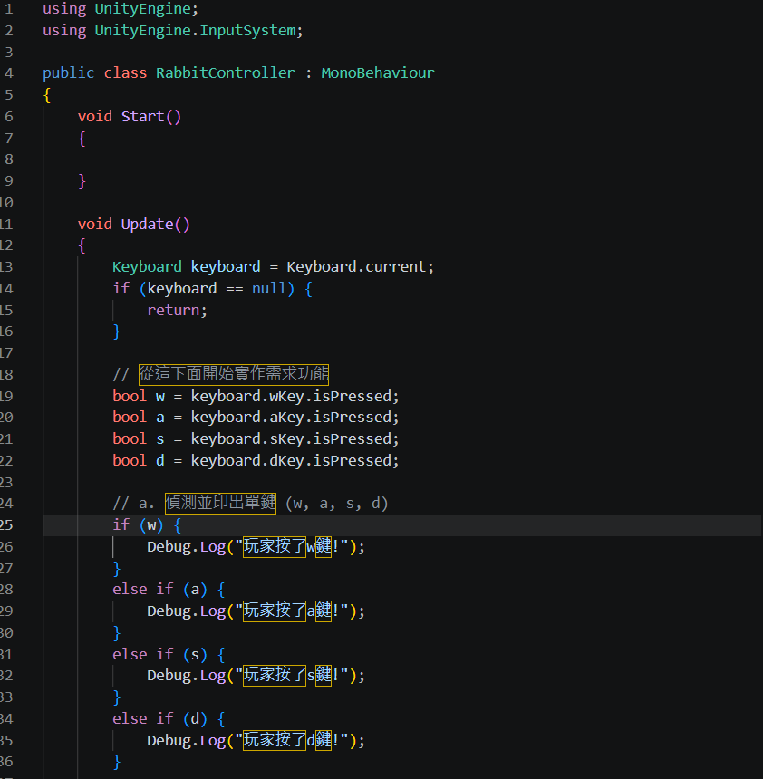
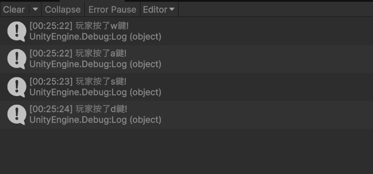
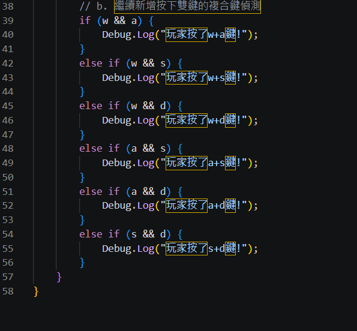
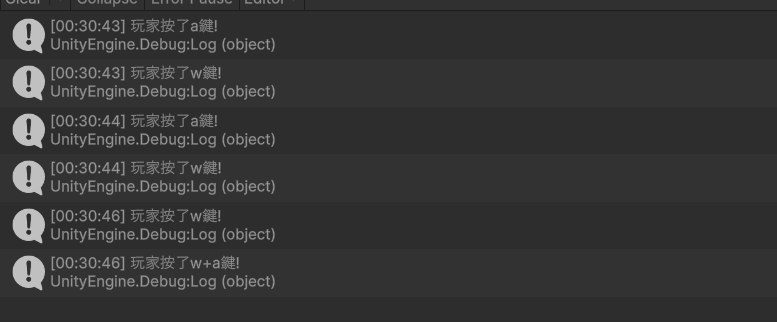
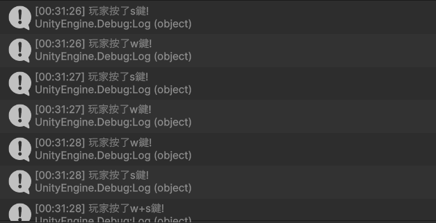
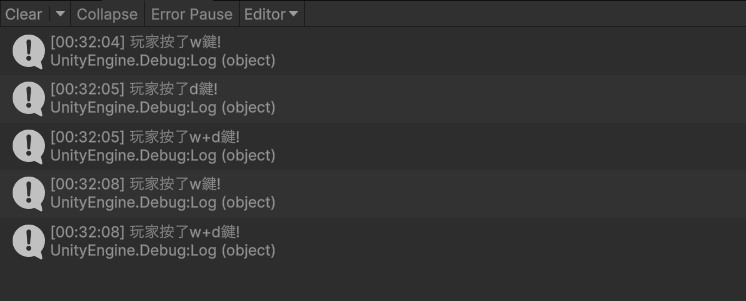
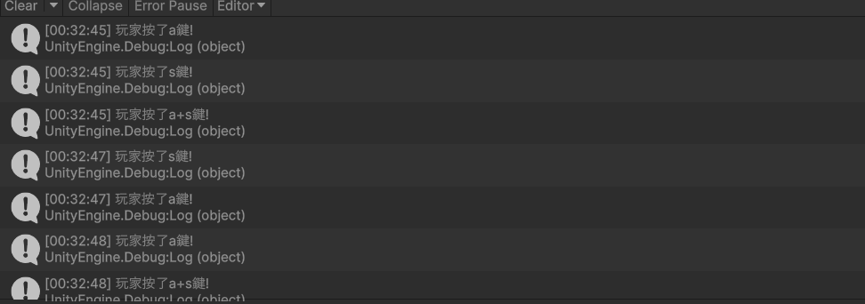
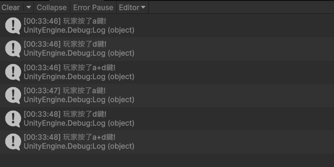
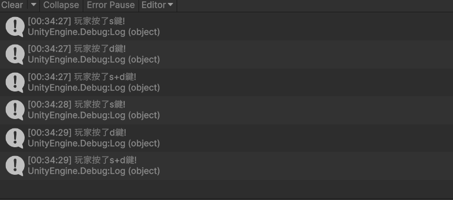

# 第2次作業題目-作業-HW2
>
>學號：113111132
> 
>姓名：曹翔凱
> 
>作業撰寫時間：130mins
> 
>最後撰寫文件日期：2026/10/25
>

本份文件包含以下主題：(至少需下面兩項，若是有多者可以自行新增)
- [x] 說明內容
- [x] 其他 (可以包含心得或是想跟老師反映)

## 說明內容

1. 
Ans:

第 1～2 列 using UnityEngine; / using UnityEngine.InputSystem;：引入 Unity 核心命名空間與新版輸入系統（Input System）工具箱，使程式能識別 Keyboard 與按鍵屬性。

第 4～5 列 public class RabbitController : MonoBehaviour {：宣告與檔名一致的公開類別 RabbitController，並繼承 MonoBehaviour 以便掛載至場景物件上。

第 6～9 列 void Start() { }：遊戲啟動時執行一次的初始化函式（本題無須初始化故留空）。

第 11～16 列 void Update() 與鍵盤檢查：每影格自動執行一次 Update()；透過 Keyboard.current 取得當前鍵盤裝置，若未偵測到鍵盤（keyboard == null）則直接 return 結束。

第 19～22 列 bool w/a/s/d = keyboard.xKey.isPressed;：分別讀取鍵盤上 wKey、aKey、sKey、dKey 目前是否被按住（.isPressed），並將布林值（true 或 false）存入對應變數 w、a、s、d 中。

第 25～36 列 if...else if 條件判斷與輸出：依序判斷變數 w、a、s、d 是否為 true；當對應按鍵被按下時，透過 Debug.Log 於主控台印出對應訊息。

執行結果說明：

如執行結果截圖（1_key.png）所示，在 Unity 中執行遊戲並依序按下鍵盤的 W、A、S、D 鍵後，Console（主控台）視窗成功偵測並依序印出「玩家按了w鍵!」、「玩家按了a鍵!」、「玩家按了s鍵!」與「玩家按了d鍵!」。
<table>
  <tr>
    <td valign="top" style="white-space:nowrap;">Ans:</td>
    <td></td>
  </tr>
</table>

程式先讀取 w、a、s、d 按鍵是否按住，再使用 && 判斷組合中的兩個按鍵是否都按下。符合條件時，程式會透過 Debug.Log 在 Console 印出對應訊息。
## 其他
在做這個作業時，我最常遇到的問題是一直按錯按鍵，導致 Console 顯示的結果跟題目不一樣。後來我透過反覆測試，才逐漸理解如何正確判斷鍵盤輸入。雖然過程中出現不少錯誤透過不斷修正與嘗試,也讓我更清楚理解程式邏輯與鍵盤輸入判斷的原理。
